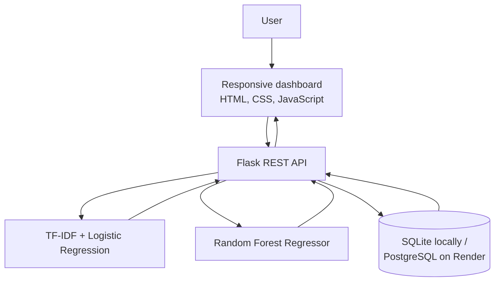

# CommerceIQ — E-Commerce Intelligence & Review Analytics

CommerceIQ is a full-stack machine-learning portfolio project for analyzing customer reviews and estimating product demand. It combines an NLP sentiment classifier, a sales-prediction model, Flask REST APIs, a relational database, and a responsive analytics dashboard.

> **Project status:** Portfolio/demo application. The bundled sentiment dataset is small and the sales model is trained on synthetic data. Predictions are for demonstrating the workflow only; they are not validated for business decisions.

## Contents

- [Features](#features)
- [Application architecture](#application-architecture)
- [Technology stack](#technology-stack)
- [Getting started locally](#getting-started-locally)
- [Configuration](#configuration)
- [API reference](#api-reference)
- [Deploy to Render](#deploy-to-render)
- [Model training and evaluation](#model-training-and-evaluation)
- [Project structure](#project-structure)
- [Known limitations and next steps](#known-limitations-and-next-steps)

## Features

### Review sentiment analysis

- Classifies customer reviews as `positive`, `neutral`, or `negative`.
- Uses a Scikit-learn `Pipeline` with TF-IDF vectorization and Logistic Regression.
- Returns the predicted class, confidence, and per-class probabilities.
- Persists each prediction in the database for the dashboard's review history.

### Sales forecasting prototype

- Estimates units sold using a Random Forest Regressor.
- Accepts product price, discount, marketing spend, average rating, and month as input features.
- Validates the incoming values before making a prediction.

### Analytics dashboard

- Displays total reviews and positive, neutral, and negative counts.
- Shows a sentiment distribution chart.
- Provides a review-analysis form and recent prediction history.
- Provides a form for generating product-demand estimates.

### Backend and deployment

- Flask application with JSON REST endpoints.
- Flask-SQLAlchemy persistence with SQLite locally and PostgreSQL through `DATABASE_URL`.
- Gunicorn production application server.
- Dockerfile and Render Blueprint configuration included.

## Application architecture



## Technology stack

| Layer | Technology |
|---|---|
| Programming language | Python |
| Backend | Flask, Flask-CORS |
| Machine learning | Scikit-learn |
| NLP | TF-IDF, Logistic Regression |
| Regression | Random Forest Regressor |
| Data processing | Pandas, NumPy |
| Model persistence | Joblib |
| ORM / database | Flask-SQLAlchemy, SQLite, PostgreSQL |
| Frontend | HTML, CSS, JavaScript |
| Production server | Gunicorn |
| Deployment | Render, Docker |

## Getting started locally

### Prerequisites

- Python 3.11 or 3.13
- Git (optional, for version control)

### Windows PowerShell

Open PowerShell in the project directory:

```powershell
cd "D:\path\to\ecommerce_intelligence"
```

Create and activate a virtual environment. The commands below use Python 3.13; change `3.13` to `3.11` if that is the version installed on your computer.

```powershell
py -3.13 -m venv .venv
.\.venv\Scripts\Activate.ps1
```

Install dependencies and start the application:

```powershell
python -m pip install --upgrade pip
pip install -r requirements.txt
python app.py
```

If PowerShell blocks virtual-environment activation, use this command for the current terminal session, then activate again:

```powershell
Set-ExecutionPolicy -Scope Process -ExecutionPolicy Bypass
.\.venv\Scripts\Activate.ps1
```

### macOS / Linux

```bash
python3.11 -m venv .venv
source .venv/bin/activate
python -m pip install --upgrade pip
pip install -r requirements.txt
python app.py
```

Open the dashboard at **http://127.0.0.1:5000**.

On first startup, the application creates the database tables and trains the demo models if the model files do not already exist. The generated model files are saved in `models/` and are excluded from Git by `.gitignore`.

## Configuration

The application reads its database connection from the `DATABASE_URL` environment variable.

| Variable | Purpose | Local default |
|---|---|---|
| `DATABASE_URL` | SQLAlchemy database connection string | SQLite database under `instance/` |
| `PORT` | Port used by the Flask development server | `5000` |
| `FLASK_DEBUG` | Enables Flask debug mode when set to `1` | Disabled |

For local development, no PostgreSQL installation is required; the application uses SQLite by default.

For Render, the included `render.yaml` provisions a PostgreSQL database and injects its connection string into the web service as `DATABASE_URL`. Keep database credentials in the hosting provider's environment settings. **Do not commit passwords, connection strings, or other secrets to GitHub.**

## API reference

The frontend calls the API on the same origin. The endpoints can also be tested independently.

### `GET /health`

Checks whether the Flask service is responding.

Example response:

```json
{
  "status": "ok",
  "service": "ecommerce-intelligence-api"
}
```

### `POST /api/sentiment`

Classifies a customer review and saves the prediction to the database.

Request:

```json
{
  "text": "The product quality is excellent and delivery was fast."
}
```

Example response (the exact values depend on the model):

```json
{
  "sentiment": "positive",
  "confidence": 0.82,
  "probabilities": {
    "negative": 0.04,
    "neutral": 0.14,
    "positive": 0.82
  },
  "id": 1
}
```

Validation: review text must contain at least 3 characters and no more than 5,000 characters.

### `POST /api/sales-prediction`

Estimates the number of units sold from product and campaign inputs.

Request:

```json
{
  "price": 79.99,
  "discount": 0.15,
  "marketing_spend": 500,
  "rating": 4.2,
  "month": 11
}
```

`discount` is a decimal between `0` and `1`; for example, 15% is `0.15`.

Example response:

```json
{
  "predicted_units": 650,
  "model_note": "Demo model trained on synthetic sample data; retrain on your own historical sales data before business use."
}
```

The prediction value above is illustrative; the actual output is generated by the model at runtime.

Validation ranges:

- `price`: greater than 0 and at most 100,000
- `discount`: 0 to 1
- `marketing_spend`: 0 to 10,000,000
- `rating`: 0 to 5
- `month`: integer from 1 to 12

### `GET /api/overview`

Returns the total number of saved reviews, sentiment counts, and the eight most recent predictions.

### `GET /api/reviews`

Returns up to 100 most recent saved review predictions.

### Example API calls

Using `curl`:

```bash
curl http://127.0.0.1:5000/health
```

```bash
curl -X POST http://127.0.0.1:5000/api/sentiment \
  -H "Content-Type: application/json" \
  -d '{"text":"The product is excellent and delivery was quick."}'
```

```bash
curl -X POST http://127.0.0.1:5000/api/sales-prediction \
  -H "Content-Type: application/json" \
  -d '{"price":79.99,"discount":0.15,"marketing_spend":500,"rating":4.2,"month":11}'
```

## Deploy to Render

The repository includes a `render.yaml` Blueprint. It defines a Python web service, its build and start commands, and a PostgreSQL database. Render can provision the resources and connect the database to the web service through `DATABASE_URL`.

1. Push the project to a GitHub repository. Ensure `app.py`, `requirements.txt`, `render.yaml`, `templates/`, `static/`, and `data/` are committed.
2. Sign in to [Render](https://dashboard.render.com/).
3. Select **New + → Blueprint**.
4. Connect the GitHub repository containing CommerceIQ.
5. Review the resources detected from `render.yaml`, then select **Apply**.
6. Wait for the build and deployment to complete.
7. Open the generated `onrender.com` URL and check `/health`.

The Blueprint sets `DATABASE_URL` from the Render PostgreSQL connection string. If you deploy the web service manually instead of using the Blueprint, create a PostgreSQL database separately and add its connection string as the web service's `DATABASE_URL` environment variable.

Useful Render documentation:

- [Render Blueprints](https://render.com/docs/blueprint-spec)
- [Deploy a Flask application](https://render.com/docs/deploy-flask)
- [Free instance limitations](https://render.com/docs/free)

### Render Free plan considerations

The free plan is useful for a portfolio demo, but it is not an always-on production environment:

- Free web services spin down after 15 minutes without inbound traffic and can take about a minute to start again.
- Free web services have an ephemeral filesystem. Local SQLite data and generated files are not durable across restarts, deploys, or spin-downs.
- Free Render PostgreSQL databases have a 1 GB limit and expire 30 days after creation unless upgraded.
- Free services can be restarted by the platform.

For durable review history, use a database plan with appropriate persistence and backups. Check Render's current plan terms before deployment because provider limits can change.

## Model training and evaluation

### Sentiment model

The application reads `data/sample_reviews.csv`, which must contain:

| Column | Description |
|---|---|
| `review` | Customer review text |
| `sentiment` | Label such as `positive`, `neutral`, or `negative` |

The pipeline uses `TfidfVectorizer` followed by `LogisticRegression`. The current bundled CSV is a small demonstration dataset. It is not large or representative enough to support a reliable real-world accuracy claim.

To retrain the sentiment pipeline on startup, replace the CSV with a properly labeled dataset and remove `models/sentiment_pipeline.joblib` before starting the application.

### Sales model

The current sales model is trained on generated synthetic rows inside `ensure_models()` in `app.py`. Its features are:

- `price`
- `discount`
- `marketing_spend`
- `rating`
- `month`

Replace the synthetic-data generation section with a training process based on representative historical sales data before using the forecast for real decisions. If the feature schema changes, update both the training data and `/api/sales-prediction` endpoint.

### Evaluation recommendations

Before reporting model performance, create a holdout test set and calculate metrics from data the model did not train on.

- Classification: precision, recall, F1-score, confusion matrix, and (where appropriate) ROC-AUC.
- Regression: MAE, RMSE, and R-squared.

Do not add unmeasured accuracy or performance claims to the README or resume.

## Project structure

```text
commerceiq/
├── app.py                       # Flask app, ML pipelines, and REST APIs
├── data/
│   └── sample_reviews.csv       # Bundled sentiment demo data
├── models/                      # Generated model files (git-ignored)
├── instance/                    # Local SQLite database (git-ignored)
├── templates/
│   └── index.html               # Dashboard HTML
├── static/
│   ├── app.js                   # Dashboard interactions and API calls
│   └── styles.css               # Dashboard styling
├── requirements.txt             # Python dependencies
├── render.yaml                  # Render Blueprint configuration
├── Dockerfile                   # Container build configuration
├── Procfile                     # Gunicorn process declaration
├── .env.example                 # Example local environment values
├── .gitignore
└── README.md
```

## Known limitations and next steps

This version is designed as a learning and portfolio project. Before treating it as a production service, consider implementing:

1. A larger, representative, licensed sentiment dataset and a proper train/test evaluation workflow.
2. Real historical sales data and a time-aware forecasting evaluation.
3. Authentication and role-based authorization for dashboard and API access.
4. Rate limiting, structured logging, monitoring, and error handling around database operations.
5. Database migrations (for example, Alembic/Flask-Migrate) instead of relying on `db.create_all()` for schema changes.
6. Pagination, data-retention controls, and privacy protections for customer review text.
7. Persistent model artifact storage or a repeatable model-training/deployment pipeline.
8. Automated tests and a CI workflow.

---

Built as a full-stack ML portfolio project using Python, Flask, Scikit-learn, SQLAlchemy, and JavaScript.
